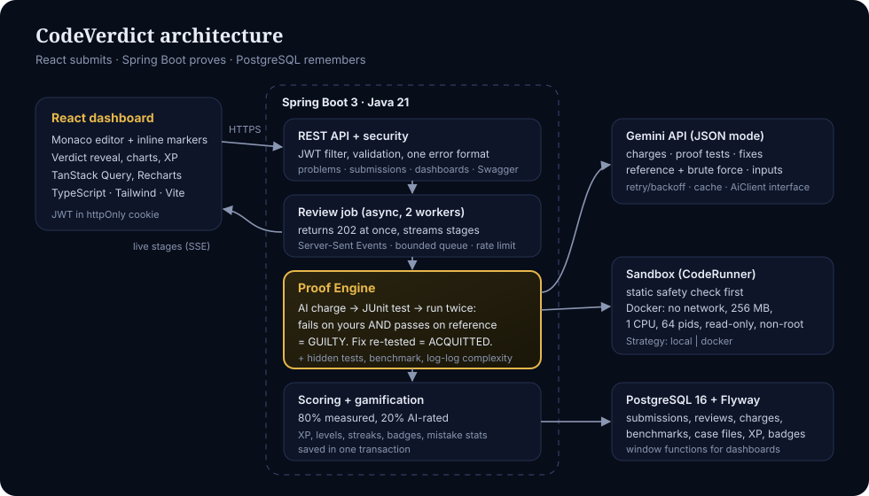

# CodeVerdict ⚖️

**Most AI code reviewers guess. CodeVerdict proves.**
Every bug it reports comes with a failing test, every speed claim comes with a measurement, and every fix is re-tested.

> Live demo: _add your link here_ · 2-minute video: _add your link here_

<!-- After your first real reviews, record the verdict reveal (docs/SETUP.md, step 9) and uncomment:

-->

---

## The problem

When you practise DSA you rarely know *exactly* what is wrong with your solution, how slow it really is, or whether you are improving.
AI reviewers give feedback, but they guess — some comments are simply wrong, so you stop trusting them. And nothing keeps a history of your mistakes, so you repeat them.

## How it works



1. You write Java in a Monaco (VS Code) editor and click **Submit for Verdict**.
2. Gemini reads the code and files **charges** (suspected bugs) with exact line numbers.
3. For each charge Gemini writes a JUnit 5 test — the **evidence**.
4. The backend compiles and runs every test **twice**: on your code and on a trusted reference solution.
5. **The double-check rule:** a charge is **GUILTY** only if its test *fails on your code* **and** *passes on the reference*.
   A wrong AI test (one that also fails on correct code) can never convict you — it is thrown out as *bad evidence*.
6. For each guilty charge Gemini proposes a fix; the backend applies it and re-runs the test and all hidden tests → **ACQUITTED**.
7. Hidden tests: Gemini writes *inputs only*; expected outputs come from running the verified reference.
8. Your code and the optimal solution are timed at n = 1k / 10k / 100k (3 warm-ups, median of 5, fixed seed); complexity is estimated from the log-log slope.
9. Everything is saved: scores, proven mistakes, timings, XP, streaks, badges.

**Where does the "trusted reference" come from?** Gemini writes an optimal *and* a brute-force solution. The reference is marked
verified only if it matches the problem's sample output and agrees with the brute force on ~60 inputs (differential testing).
It is cached per problem so every attempt is judged against the same reference and the same inputs.

### Verdict score (0–100) — 80% measured, 20% AI opinion

| Part | Points | How |
|---|---|---|
| Correctness | 40 | 40 × hidden tests passed ÷ total |
| Performance | 30 | vs optimal at the largest n: ≤2× → 30, ≤10× → 20, finishes → 10, too slow → 0 |
| Edge cases | 10 | 10 − 3 per proven edge-case charge |
| Code quality | 20 | AI rubric: naming, readability, structure, duplication (0–5 each) |

Grades: S ≥ 95 · A ≥ 85 · B ≥ 70 · C ≥ 50 · D below.

## Features

| Page | What you get |
|---|---|
| **Home** | Level, XP bar, streak, today's challenge from your weakest topic, "continue where you left off" |
| **Case Editor** | Monaco with Java highlighting, Run on sample input, Submit (Ctrl+Enter), autosaved drafts |
| **Verdict** | Stamp + score count-up, score breakdown, Guilty / Dismissed / Acquitted charges with proof test and real error output, red markers on the exact lines, fix diff + Apply fix, hidden tests, speed chart vs optimal, "key idea you missed" |
| **History** | Every submission with filters, compare two attempts side by side (diff + score change) |
| **Progress** | Weekly average score, topic strength, top repeated (proven) mistakes, activity heatmap |
| **Records** | Best attempt per problem vs optimal — green / yellow / red cards |
| **Achievements** | Levels Intern → Principal, 10 badges, confetti on real wins only |
| **Settings** | Theme, sound, daily goal, Gemini key status, CSV export |

10 classic problems (Two Sum, Valid Parentheses, Merge Intervals, Number of Islands, …) are added to every new account; you can add your own.

## Evaluation (real numbers only)

The question: *does proving charges remove false alarms without losing real bugs?*
30 Java snippets (20 with one known bug, 10 correct) are reviewed in two modes: **A — AI only** (every charge Gemini raises) vs **B — CodeVerdict** (only proven charges).

| Metric | A: AI only | B: CodeVerdict |
|---|---|---|
| False alarms | _run it_ | _run it_ |
| Bugs caught (/20) | _run it_ | _run it_ |
| Precision | _run it_ | _run it_ |

Run it yourself: `cd backend && mvn test -Dtest=EvaluationTest -Deval=true -Deval.runs=3` (needs `GEMINI_API_KEY`).
The table is written to [`docs/eval/results.md`](docs/eval/results.md). The snippets and ground truth are in [`docs/eval/`](docs/eval).

## Tech stack

| Layer | Tools |
|---|---|
| Backend | Java 21, Spring Boot 3.5 (Web, Validation, Security + JWT, Data JPA), Flyway, springdoc-openapi |
| Proof Engine | `javax.tools.JavaCompiler` (in-process), JUnit 5 console launcher, Docker sandbox, custom benchmark harness |
| AI | Gemini 2.5 Flash via REST in JSON mode with response schemas; retry with backoff; result cache |
| Database | PostgreSQL 16 (window functions, `date_trunc`, `LATERAL`, JSONB) |
| Frontend | React 18, TypeScript, Vite, Tailwind, Radix UI, Monaco, Recharts, Framer Motion, TanStack Query |
| Quality | JUnit 5, Testcontainers, Vitest + Testing Library, GitHub Actions |

## Run locally

```bash
cp .env.example .env              # add your free Gemini key from https://aistudio.google.com/apikey
docker compose up --build         # Postgres + backend + frontend
# open http://localhost:3000  (demo login: demo / demo1234)
```

Development mode (hot reload), full Windows walkthrough and troubleshooting: **[docs/SETUP.md](docs/SETUP.md)**.
API docs: http://localhost:8080/swagger-ui.html

## Design decisions & trade-offs

- **Why prove instead of trust?** LLM reviews have false positives. Running a test against the user's code *and* a verified reference turns an opinion into a fact and filters bad AI tests automatically.
- **Why async + SSE?** A review takes 10–60 s. The API returns `202` immediately; progress is pushed over Server-Sent Events (one-way, plain HTTP, auto-reconnect — simpler than WebSockets, and no polling). Late subscribers get a replay of the stages so far.
- **Why a reference *and* a brute force?** The reference decides guilt, so it must be right. Two independently written solutions that agree on ~60 inputs are much more trustworthy than one.
- **Why expected outputs from running code?** An AI asked "what should this return?" can be wrong; running the verified reference cannot.
- **Why Docker for running code?** It is untrusted code written by a user *and* an AI. Defence in depth: static safety check (no files, network, threads, reflection, `System.exit`, unicode-escape tricks) → container with no network, 256 MB, 1 CPU, 64 PIDs, read-only FS, non-root, hard timeouts, capped output.
- **Why compile in-process?** `javax.tools.JavaCompiler` avoids a JVM start-up per compile; compiling never executes code (`-proc:none`), only running needs the sandbox.
- **Why batch AI calls?** The free tier allows ~10 requests/minute. Proof tests and fixes are requested in one call each; independent calls (charges, quality) run in parallel; identical code is served from cache; the reference and test inputs are cached per problem in PostgreSQL.
- **Why JPA *and* plain SQL?** JPA for simple CRUD; `NamedParameterJdbcTemplate` for analytics (window functions, `LATERAL`), where SQL is clearer and faster than an ORM.
- **Patterns:** Strategy (`CodeRunner`: local / docker, `AiClient`: Gemini / unavailable), Decorator (`CachingAiClient`), Pipeline (`ProofEngine` stages). The engine has **no Spring dependency**, so it is unit-tested on its own.

## Limitations & future work

- Java only (Python could be added behind the same `CodeRunner` interface).
- Benchmark noise on shared machines; mitigated with warm-ups, medians, a noise floor and a 2× tolerance. O(n) vs O(n log n) cannot be separated by slope alone, so the AI estimate breaks the tie and the UI labels it.
- One job queue in memory: for many users, move jobs to Redis/RabbitMQ and run separate runner workers with a warm container pool.
- AI cost: ~5 calls per review (cached where possible); token usage is logged per review.
- Problems with several valid answers need the right "output order" setting (exact / any order / any order nested).

## Project layout

```
backend/   Spring Boot app (package by feature: auth, problem, submission, review, proof, runner, benchmark, ai, dashboard, gamification)
frontend/  React + TypeScript dashboard
docs/      architecture, setup guide, interview notes, evaluation set
```

---

Built by **Aaliya Khan** · [GitHub](https://github.com/Aliakhan786)
